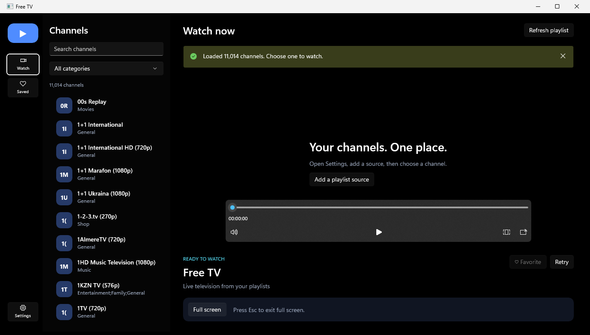

# FreeTV

A native Windows IPTV player for public M3U channel catalogues, built with **C# / .NET 8 and WinUI 3 (Windows App SDK)**.
Paste a playlist URL, then search, filter by category and watch. Favourites and the channel cache are kept locally.



## Features

- **M3U catalogue loading** from any public HTTP/HTTPS URL. The [iptv-org](https://github.com/iptv-org/iptv) public index is prefilled (about 11,000 channels).
- **Channel browser**: instant search, category filter (from `group-title`, including multi-category entries) and a live channel count.
- **Player** built on Windows `MediaPlayer` (HLS/DASH): play/pause, volume, aspect ratio, full-window and full-screen modes, and *Retry* for flaky streams.
- **Favourites**, with a Saved view in the left rail.
- **Offline-friendly cache**: the last loaded catalogue, source and favourites persist in `%LOCALAPPDATA%\FreeTV\settings.json` and survive restarts. A failed refresh keeps the previous catalogue.
- **Themes**, including an OLED-black default.

FreeTV **ships no channels or streams**. It only plays the URLs listed in the catalogue you choose, and channel availability depends on those public sources and your region.

## Robust playlist parsing

`Playlist.cs` is a standalone M3U parser with its own test runner (`Tests/`). It handles:

- UTF-8 BOM and CRLF line endings
- quoted attribute values containing commas
- relative stream URLs resolved against the catalogue URL
- duplicate entries
- rejecting non-HTTP schemes and invalid input
- detecting when an HLS media manifest was pasted instead of a channel catalogue

It also caps downloads at 32 MB with a 45-second timeout.

## Tech stack

| Area | Choice |
|---|---|
| UI | WinUI 3 (Windows App SDK 2.4), unpackaged self-contained app |
| Playback | `Windows.Media.Playback.MediaPlayer` + `MediaPlayerElement` |
| Networking | `HttpClient` with timeout and response-size limit |
| Parsing | Custom M3U / `#EXTINF` / `#EXTGRP` parser (`record Channel(Name, Group, Url)`) |
| Tests | Console test runner (`Tests/ParserTests.csproj`) that reuses `Playlist.cs` |

`index.html` and `theme-proposals.html` are the original HTML design mock-ups the native UI was built from.

## Build and run

**Requirements:** Windows 10 1809 or later (Windows 11 recommended) and the [.NET 8 SDK](https://dotnet.microsoft.com/download/dotnet/8.0).

```powershell
git clone https://github.com/Prathapdom/FreeTV.git
cd FreeTV

# Build and run
dotnet build FreeTV.csproj -c Debug -p:Platform=x64
.\bin\x64\Debug\net8.0-windows10.0.26100.0\win-x64\FreeTV.exe

# Parser tests
dotnet run --project .\Tests\ParserTests.csproj
# Optional live check against the public index:
dotnet run --project .\Tests\ParserTests.csproj -- https://iptv-org.github.io/iptv/index.m3u

# Portable folder build (copy the whole folder; no .NET install needed)
dotnet publish FreeTV.csproj -c Release -o .\publish
```

**Using it:** open **Settings** (bottom of the left rail), keep or change the playlist URL, select **Save and load channels**, then pick a channel.
To keep test data separate from your own, set `FREETV_DATA_DIR` to a temporary folder before launching.

## Limitations

- Codec and HLS/DASH support comes from Windows, so some channels may be offline, region-restricted or unsupported.
- EPG schedules, recording, DRM logins and VLC-specific stream options are not implemented.
